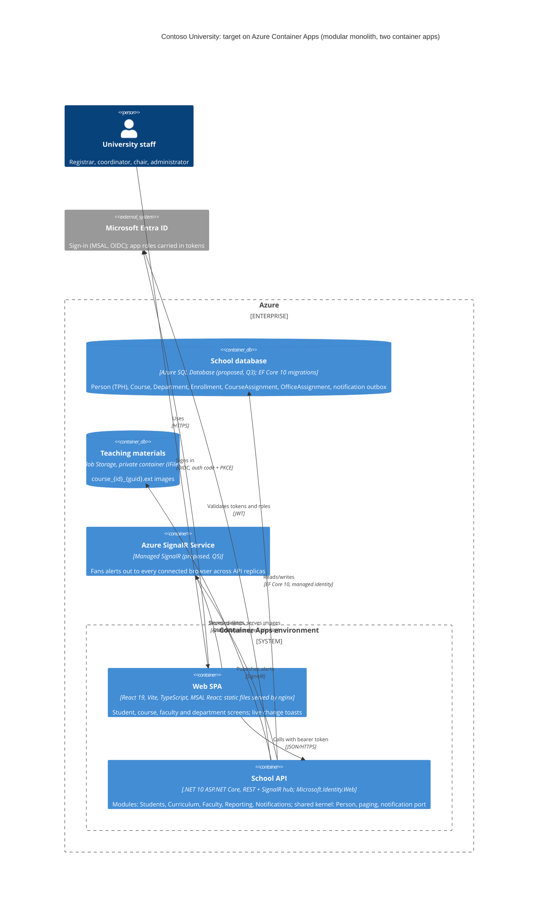
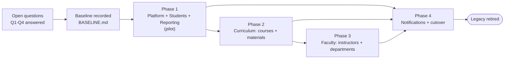

# Modernization Brief: contoso

Date: 2026-10-26
Status: **Draft, awaiting approval**
Pattern: **Reimagine** (rebuild from extracted intent), per `INTENT.md`
Target: .NET 10 ASP.NET Core REST API container + React 19 SPA container on **Azure Container Apps**; Clean Architecture, vertical slices grouped by bounded context (modular monolith); images in Azure Blob Storage; sign-in with Microsoft Entra ID

Inputs (all in `analysis/contoso/`, last modified 2026-10-26):

| Input | Time | Notes |
|---|---|---|
| `INTENT.md` | 14:41, updated later the same day | Goal, target, "behavior must match exactly, including known quirks"; update: Azure Container Apps, Blob Storage, Entra |
| `PREFLIGHT.md` | 14:45 | Complete system, standalone, nothing off limits, no prior attempts |
| `ASSESSMENT.md`, `ARCHITECTURE.mmd` | 14:54 | Complexity index 13.5; 22 security findings; no tests |
| `topology.json`, `*.mmd` | 15:02–15:05 | 4 persona flows, 8 entry points |
| `BUSINESS_RULES.md`, `DATA_OBJECTS.md` | 15:15 | 49 rules (2 P0), 18 needing SME confirmation |
| `RULE_REVIEWS.json` / `.md` | 15:22 | RULE-006 confirmed (with a fix), RULE-033 wrong |

`DELTA_CATALOG.md` does not apply: this is a cross-stack rebuild, not a same-stack uplift.

**How to steer this plan:** edit this file. The build commands read the phase blocks below and treat the entry and exit criteria as binding. They may tick a box or add a `Proposed revision:` line for you to accept, but they never reword a criterion. An edited criterion is honored; a chat message is not.

---

## 1. Objective

Contoso University is a 4 KSLOC ASP.NET MVC 5 app on .NET Framework 4.8. It handles student, course, instructor and department records, stores uploaded teaching-material images on local disk, and sends live change alerts through MSMQ. Three of its foundations have no future: System.Web and MSMQ don't exist on modern .NET, and EF Core 3.1 has been out of support since 2022. It has no tests and no authentication, and an overposting flaw lets any visitor delete any file under the web root (SEC-002). The goal is to rebuild it as a .NET 10 REST API plus a React 19 SPA, deployed as two container apps on Azure Container Apps and organized as Clean Architecture vertical slices by bounded context. Uploaded images move to Azure Blob Storage, and sign-in uses Microsoft Entra ID. The new system must reproduce today's business behavior, except where a person has recorded a deliberate change in `RULE_REVIEWS.json`. Now is the right time because the system is small (complexity index 13.5), its rules are already extracted and cited, and a rebuild costs less than porting System.Web and MSMQ code that would be thrown away.

## 2. Target Architecture



Container Apps may run several API replicas, which shapes three decisions:
- **Images:** they can't stay on local disk. They go to a private Blob container behind `IFileStorage`, and the API serves them (or issues short-lived SAS links) so the access policy applies.
- **Alerts:** a SignalR hub inside a single replica only reaches the browsers connected to that replica. The proposal is to publish events through an outbox table in the database and fan them out with Azure SignalR Service. The alternative is to pin the API to one replica. That decision is Q5.
- **Secrets:** the API reaches SQL and Blob through a managed identity, so no connection secrets are stored.

Local development runs the same two containers in `docker compose`, with SQL Server in a container and Azurite standing in for Blob Storage. **Local development and tests need no Entra tenant** (`INTENT.md` update):
- **API:** a development authentication scheme replaces Entra JWT validation. It signs every request in as a configurable fake user whose roles come from local settings or a request header. The rest of the authorization pipeline stays the same, so role policies are still enforced and tested.
- **SPA:** a dev auth mode skips MSAL and shows a "sign in as" picker listing the Q1 roles.
- **Tests:** the API tests use the same scheme through `WebApplicationFactory`, so they run offline.
- **Guard rails:**
  - The bypass turns on only when `ASPNETCORE_ENVIRONMENT=Development` *and* an explicit `Auth:Mode=Development` setting are both present.
  - The API refuses to start if the bypass is configured in any other environment.
  - The SPA's dev mode is a build-time flag that production builds leave out.
  - The deployed Container Apps configuration never sets the bypass.

Anyone who wants real sign-in locally can switch to `Auth:Mode=Entra` with a dev app registration.

Each module is a vertical-slice project set (`Domain`, `Application/Features/<slice>`, `Infrastructure`) behind a single API host. The detailed architecture is approved at `reimagine`'s second human checkpoint.

| Legacy component | Target component(s) |
|---|---|
| `Global.asax.cs`, `RouteConfig`, `FilterConfig`, `BundleConfig`, `Web.config` | API `Program.cs` (DI, routing, ProblemDetails, Entra JWT auth + role policies, options); SPA router + Vite build + MSAL; Container Apps config and infrastructure-as-code |
| `Views/Shared` (`_Layout`, Error) | SPA app shell, navigation, error boundary |
| `BaseController` | Removed: constructor injection of `DbContext`, `INotificationPublisher`, `ICurrentUser` |
| `SchoolContext`, `SchoolContextFactory` | Infrastructure `SchoolDbContext` (EF Core 10) + initial migration matching today's schema |
| `DbInitializer` | Idempotent seeder (same seed data, RULE-030 gate) |
| `PaginatedList` | Shared kernel `PagedResult<T>` (RULE-002) |
| `Person`, `Student`, `Instructor` (TPH) | Shared kernel `Person` + Students/Faculty aggregates on one TPH table (RULE-041) |
| `StudentsController`, `Views/Students`, `Student`, `Enrollment` | **Students** module slices + SPA student pages |
| `HomeController`, `Views/Home`, `EnrollmentDateGroup` | **Reporting** module (enrollment statistics, RULE-001) + SPA home/about |
| `CoursesController`, `Views/Courses`, `Course` | **Curriculum** module slices + `IFileStorage` + SPA course pages |
| `InstructorsController`, `DepartmentsController`, their views, `Department`, `OfficeAssignment`, `CourseAssignment`, `InstructorIndexData`, `AssignedCourseData` | **Faculty** module slices + SPA instructor/department pages |
| `NotificationService`, `NotificationsController`, `Views/Notifications`, `notifications.js`, `Notification`, MSMQ queue | **Notifications** module: `INotificationPublisher` → outbox → Azure SignalR Service; SPA toast component |
| `ds:Disk:Uploads/TeachingMaterials` | Azure Blob Storage private container via `IFileStorage`, served through an API endpoint |
| `BaseController` user hardcoded to `"System"` | `ICurrentUser` from the Entra token (whether alerts show the real actor is Q5) |
| `LoggingService`, `ErrorViewModel` (dead ends) | Dropped; `ILogger<T>` and ProblemDetails replace them |

## 3. Phased Sequence

The order follows the strangler-fig principle: lowest risk and fewest dependencies first. Phase 1 builds the platform and the two cleanest contexts (topology: "Students and Home are the cleanest extraction candidates"). Curriculum comes next. Faculty follows, because it reads Courses and writes Departments. Notifications comes last, because every other module only publishes to it through a port. The new system replaces the old one at a single cutover at the end of Phase 4. There is no live routing between the two stacks, since the system is small and has no external consumers (PREFLIGHT Check 6).

**Phase 1 is a pilot, and this brief is a hypothesis.** The legacy app has never been run in this environment: it needs the .NET Framework 4.8 Developer Pack and the MSMQ feature. What the pilot surfaces is *expected* to revise this brief. That might be a behavior the analysis missed, a prerequisite that reorders the phases, or an environment fact nobody wrote down. Regenerating the brief after Phase 1 is the normal path.



#### Phase 1 — Platform foundation, Students and Reporting (pilot)
Command: /code-modernization:modernize-reimagine
Modules: Global.asax.cs, RouteConfig, FilterConfig, BundleConfig, Web.config, Views/Shared, BaseController, SchoolContext, SchoolContextFactory, DbInitializer, PaginatedList, Person, Student, Enrollment, StudentsController, Views/Students, HomeController, Views/Home, EnrollmentDateGroup, ds:Person, ds:Enrollment
Scale: M
Risk: High; (1) the legacy app cannot run here yet (no 4.8 targeting pack, no MSMQ), so there is no oracle for "exact match": mitigated by making a recorded baseline an entry criterion; (2) the access model (RULE-033 marked wrong) touches every endpoint built from here on: mitigated by deciding the Entra role matrix (Q1) before this phase and building deny-by-default authorization into the host.
Entry criteria:
- [ ] Open questions Q1–Q4 in §7 are ticked with a recorded answer
- [ ] .NET Framework 4.8 Developer Pack and the MSMQ Windows feature are installed, and the legacy app builds and serves `/Students` locally
- [ ] Legacy baseline for the Students and Home flows (requests, responses, resulting database rows) is recorded in `analysis/contoso/BASELINE.md`
- [ ] Target architecture approved at `reimagine`'s architecture checkpoint
- [ ] An Entra tenant and a dev app registration (SPA + API, with the app roles from Q1) are available for the deployed dev environment (local development and tests do not need them)
Exit criteria:
- [ ] `docker compose up` starts the API and SPA containers, SQL Server and Azurite, and the seeder produces the same seed rows as legacy `DbInitializer` (row-count and value diff against the baseline is empty)
- [ ] Infrastructure-as-code deploys both container apps, the database and the storage account to a dev Azure Container Apps environment, and the deployed SPA signs in through Entra and lists students
- [ ] The EF Core 10 initial migration reproduces the legacy schema: tables, TPH discriminator, `datetime2` columns, composite key on CourseAssignment, RowVersion on Department
- [ ] Every Students and Reporting rule (RULE-001, 002, 003, 010, 018, 019, 022, 029, 030, 040, 041, 047, 048) has a passing test, and each test cites its rule id
- [ ] The "Register a new student" flow, replayed against both systems, yields identical database state and an identical list page (search, sort, page of 10)
- [ ] Every endpoint enforces the Entra role policy recorded for Q1, with tests for allowed, denied and anonymous callers
- [ ] With network access to Entra blocked, `docker compose up` in Development mode and the full test suite both work, signing in as each Q1 role through the development auth scheme
- [ ] Starting the API with `Auth:Mode=Development` in a non-Development environment fails at startup (tested), the production SPA bundle contains no dev sign-in code, and the deployed dev environment rejects a request carrying the dev role header
- [ ] Student create/update/delete publishes an event through `INotificationPublisher` with the RULE-005 wording (asserted at the port)

#### Phase 2 — Curriculum: courses and teaching materials
Command: /code-modernization:modernize-reimagine
Modules: Course, CoursesController, Views/Courses, ds:Course, ds:Disk:Uploads/TeachingMaterials
Scale: S
Risk: Medium; (1) the legacy upload path is a critical vulnerability (SEC-002, RULE-024: client-supplied old-image path is deleted from disk): mitigated by Q6, decided before the phase, never changed silently; (2) local-disk storage does not survive container restarts or scale-out: mitigated by `IFileStorage` on a private Azure Blob container, with Azurite for local tests.
Entry criteria:
- [ ] Phase 1 exit criteria are all ticked
- [ ] Q6 (upload path, type check, size limit) and Q7 (course deletion with enrollments) are ticked with a recorded answer
- [ ] Legacy baseline for the "Publish a course with its textbook image" flow is recorded in `analysis/contoso/BASELINE.md`
Exit criteria:
- [ ] Every Curriculum rule (RULE-007, 013, 020, 021, 024, 025, 026, 035, 042) has a passing test citing its rule id, written to the answers recorded for Q6 and Q7
- [ ] The course flow, replayed against both systems, yields identical Course rows and a blob named `course_{id}_{guid}.ext`
- [ ] No API input can name a blob or path that the server deletes or serves (a negative test posts `~/Web.config`-style paths and other courses' blob names)
- [ ] The Blob container is private: an image URL without the API (or an expired SAS link) is refused

#### Phase 3 — Faculty: instructors and departments
Command: /code-modernization:modernize-reimagine
Modules: Instructor, Department, OfficeAssignment, CourseAssignment, InstructorIndexData, AssignedCourseData, InstructorsController, DepartmentsController, Views/Instructors, Views/Departments, ds:Department, ds:OfficeAssignment, ds:CourseAssignment
Scale: M
Risk: Medium; (1) RULE-006 is a deliberate change from legacy (the deliberate overwrite must work, and legacy's doesn't), so a straight dual-run diff would flag it: mitigated by asserting the reviewed behavior, not the legacy trace, for that one step; (2) cross-context writes (instructor delete clears `Department.InstructorID`; assignments read Courses): mitigated by keeping Faculty and Curriculum on one DbContext and transaction.
Entry criteria:
- [ ] Phase 2 exit criteria are all ticked
- [ ] Q8 (department name required, budget limits) and Q9 (one instructor administering several departments) are ticked with a recorded answer
- [ ] Legacy baseline for the "Assign an instructor to courses and an office" flow and the department edit conflict is recorded in `analysis/contoso/BASELINE.md`
Exit criteria:
- [ ] RULE-006 is proven as reviewed: a stale save is blocked with "Current value" per conflicting field, a deliberate second save succeeds, a stale delete is blocked, and a save against a deleted department shows the deleted message
- [ ] Every Faculty rule (RULE-008, 009, 012, 014, 016, 017, 027, 028, 036, 043, 045, 046, 049) has a passing test citing its rule id
- [ ] The instructor flow, replayed against both systems, yields identical Person, OfficeAssignment and CourseAssignment rows

#### Phase 4 — Notifications and cutover
Command: /code-modernization:modernize-reimagine
Modules: Notification, NotificationService, NotificationsController, Views/Notifications, notifications.js, ds:MSMQ:ContosoUniversityNotifications
Scale: S
Risk: Medium; (1) legacy delivery is destructive and first-poller-wins (RULE-038), the "admin-only" audience does not exist, and on Container Apps an in-process hub misses browsers on other replicas: mitigated by Q5, decided before the phase; (2) the legacy toast renders with `innerHTML` (stored XSS, SEC-003): mitigated by rendering text only in React.
Entry criteria:
- [ ] Phases 1–3 exit criteria are all ticked
- [ ] Q5 (notification audience and delivery) is ticked with a recorded answer
- [ ] Data migration source decided (Q3) and, if real data exists, a migration script has been rehearsed on a copy
Exit criteria:
- [ ] Every Notifications rule (RULE-004, 005, 031, 032, 034, 038) has a passing test citing its rule id, written to the Q5 answer
- [ ] The "See live change alerts" flow works end to end on Azure Container Apps with the API scaled to at least 2 replicas: a change in one browser produces a toast in another within the agreed latency
- [ ] All four persona flows pass manual UAT by a named business user on the production Container Apps environment
- [ ] The legacy app is switched off and the new container apps serve production traffic

## 4. Business Walkthroughs

**Register a new student** (persona: Registrar)

| Step (business language) | Legacy modules | Replaced in |
|---|---|---|
| Open the student list from the navigation bar | Views/Shared, RouteConfig, StudentsController | Phase 1 |
| Fill in name and enrollment date (defaults to today) | Views/Students | Phase 1 |
| Check the date is real and save the student | StudentsController, BaseController, SchoolContextFactory, ds:Person | Phase 1 |
| Tell administrators about the new student | NotificationService, ds:MSMQ | Phase 1 publishes; Phase 4 delivers |
| Return to the searchable, paged list | StudentsController, PaginatedList, Views/Students | Phase 1 |

**Publish a course with its textbook image** (persona: Department coordinator)

| Step | Legacy modules | Replaced in |
|---|---|---|
| Open the new-course form with the department list | CoursesController, ds:Department, Views/Courses | Phase 2 |
| Check the image type and size and store the file | CoursesController, ds:Disk:Uploads/TeachingMaterials | Phase 2 |
| Save the course | CoursesController, ds:Course | Phase 2 |
| Announce the new course | NotificationService, ds:MSMQ | Phase 2 publishes; Phase 4 delivers |
| Show the course list with thumbnails | Views/Courses, ds:Disk | Phase 2 |

**Assign an instructor to courses and an office** (persona: Department chair)

| Step | Legacy modules | Replaced in |
|---|---|---|
| Pick an instructor and see their courses and students | InstructorsController, InstructorIndexData, ds:Person, ds:CourseAssignment, ds:Enrollment, Views/Instructors | Phase 3 |
| Open the edit form with the course checklist | InstructorsController, AssignedCourseData, ds:Course, Views/Instructors | Phase 3 |
| Save office location and course assignments | InstructorsController, ds:OfficeAssignment, ds:CourseAssignment, ds:Person | Phase 3 |
| Announce the change | NotificationService, ds:MSMQ | Phase 3 publishes; Phase 4 delivers |

**See live change alerts** (persona: Administrator)

| Step | Legacy modules | Replaced in |
|---|---|---|
| Any page loads the alert feature | Views/Shared, notifications.js | Phase 4 |
| The page keeps asking for new alerts (every 5 s today) | notifications.js, NotificationsController | Phase 4 |
| Take up to 10 alerts off the queue | NotificationService, ds:MSMQ | Phase 4 |
| Show each alert as a pop-up | notifications.js | Phase 4 |

## 5. Behavior Contract

These P0 rules must be proven before the phase that covers them ships. They head the regression suite.

| Rule | Behavior | Phase | Status |
|---|---|---|---|
| RULE-006 | Department edits use optimistic concurrency, first save wins. A stale save is blocked and each conflicting field shows its current value. **A deliberate second save overwrites.** A stale delete is blocked the same way. | 3 | **Confirmed by a person** (2026-10-26) with a recorded change: legacy's second save fails because the stale RowVersion is re-posted, and the rebuild must make it work. This is an approved deviation from the legacy trace. |
| ~~RULE-033~~ | No authentication or authorization on any page | — | **Not in the contract.** A reviewer marked it *wrong*. See Q1; it blocks Phase 1. |

Because `INTENT.md` asks for an exact match including quirks, the 47 P1/P2 rules are also in the regression suite as characterization tests, one per rule, cited by id in each phase's exit criteria. They are not P0 gates, but a failing P1 test blocks its phase's exit criterion all the same. Medium- and Low-confidence P1 rules with open SME questions are listed in §7 and assigned to their phase.

## 6. Validation Strategy

The legacy UI is server-rendered Razor and the new one is a React SPA, so the two can't be compared page by page. Equivalence is proven on **business outcomes**: database state after each step, the data each screen shows, validation messages, and published notification events.

| Phase | Characterization tests | Contract tests | Dual-execution diff | Property-based | Manual UAT |
|---|---|---|---|---|---|
| 1 | Recorded legacy traces for Students and Home, replayed against the API | OpenAPI contract for every Students/Reporting endpoint; SPA ↔ API contract tests | Seed data and the registration flow: diff of database rows | Paging (RULE-002: page count, bounds, page size 0), date range 1753–9999 (RULE-010) | Registrar walkthrough |
| 2 | Course CRUD and upload traces | Course endpoints; file-serving endpoint | Course flow: diff of Course rows and stored file names | Upload acceptance: extension × case × size (RULE-007, RULE-020) | Coordinator walkthrough |
| 3 | Instructor and department traces | Faculty endpoints, including the 409 conflict response shape | Instructor flow: diff of rows. **The RULE-006 second save is excluded from the diff** and asserted against the review note | Assignment sync: any old set → any new set gives exactly the new set (RULE-027) | Chair walkthrough, including a two-browser conflict |
| 4 | Notification wording and relative-time traces | SignalR message contract | Event stream: each legacy MSMQ message has a matching outbox event | Relative time across boundaries (RULE-004) | Administrator walkthrough; full UAT of all four flows before cutover |

## 7. Open Questions

Tick each box once its answer is written here or recorded with `/code-modernization:modernize-review`.

**Before Phase 1**

- [ ] **Q1: Access model (RULE-033, reviewed *wrong*; also RULE-037, RULE-039).** Today anyone can view and change everything. The identity provider is Microsoft Entra ID ("likely", `INTENT.md` update); confirm it. Still open: which Entra app roles exist (for example Admin, Teacher, Registrar), and what each may do per entity (view, create, edit, delete)? The legacy comments suggest Admins and Teachers can view students and only admins can delete, but nothing enforces it. Which tenant should the app registrations live in?
- [ ] **Q2: When "match exactly, including quirks" (`INTENT.md`) and a recorded review disagree, which wins?** This brief assumes the review wins, as with RULE-006 and RULE-033. Confirm, and say whether the security quirks listed in Q6 count as quirks to keep or defects to fix.
- [ ] **Q3: Data.** Is there a production database to migrate, or is the seed data the whole dataset? This brief proposes Azure SQL Database, accessed through managed identity; confirm it, or name an existing server. Also say which Azure subscription and region the Container Apps environment goes in, and whether infrastructure-as-code should be Bicep or Terraform.
- [ ] **Q4: Legacy environment.** Who installs the .NET Framework 4.8 Developer Pack and the MSMQ feature on this machine so the baseline can be recorded? Without them there is no oracle for "exact match" (PREFLIGHT 3b, 3c).

**Before Phase 2**

- [ ] **Q6: Uploads (RULE-024, RULE-007, RULE-020; SEC-002, SEC-011).** Images move to Azure Blob Storage ("likely", `INTENT.md` update); confirm it, and say whether existing files under `Uploads/TeachingMaterials` must be copied over. May the rebuild take the old image name from the database instead of the form, which closes the arbitrary-file-delete flaw? Should file contents be checked, not just the extension? Which size limit applies, 5 MB (code) or 10 MB (`Web.config`)?
- [ ] **Q7: Course deletion (RULE-025).** Should a course with enrollments or instructor assignments be deletable? If so, should its enrollments cascade?

**Before Phase 3**

- [ ] **Q8: Department fields (RULE-008, RULE-014).** Should the department name be required? Should Budget be non-negative, or have a maximum?
- [ ] **Q9: Department administrator (RULE-028, RULE-043, RULE-049).** May one instructor administer several departments? Legacy throws an error when you delete such an instructor.

**Before Phase 4**

- [ ] **Q5: Notifications (RULE-038, RULE-031, RULE-032, RULE-034).** Who should see change alerts: every signed-in user, admins only, or someone else? Should every admin see every alert, rather than whoever's browser polls first as today? Should alerts be kept, with read/unread state, or stay fire-and-forget? Should the actor be the signed-in Entra user instead of "System"? Transport on Container Apps: Azure SignalR Service (proposed, works across replicas), or keep the API at a single replica and host the hub in-process?

**Can be answered during their phase** (the tests follow the legacy behavior until an answer is recorded)

- [ ] RULE-011: Is "one enrollment per student per course" a real rule (today it only exists in the seeder), and are retakes allowed?
- [ ] RULE-029: When a student with enrollments is deleted, should enrollments cascade, should the delete be blocked, or should the student be deactivated?
- [ ] RULE-042: Chemistry is seeded under Engineering. Keep it as is, or correct the seed?
- [ ] 500 errors instead of 404 for unknown ids (RULE-021, RULE-022): keep them, or return 404?
- [ ] CI: no pipeline exists. Where should the new system's pipeline run?

## 8. Approval Block

```
Approved by: ________________  Date: __________
Approval covers: Phase 1 only | Full plan
```
